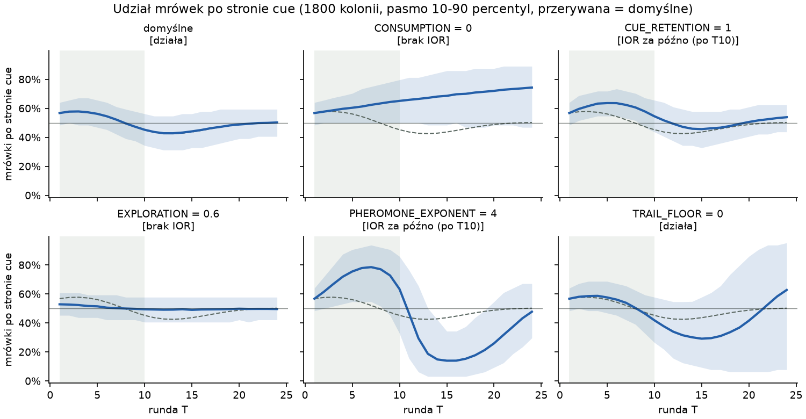
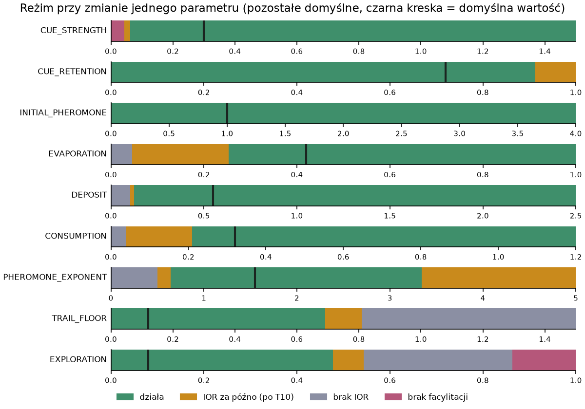
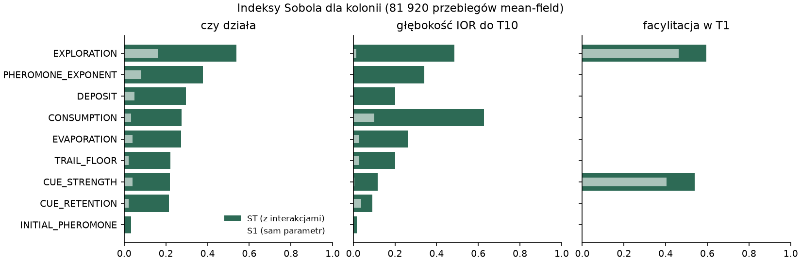
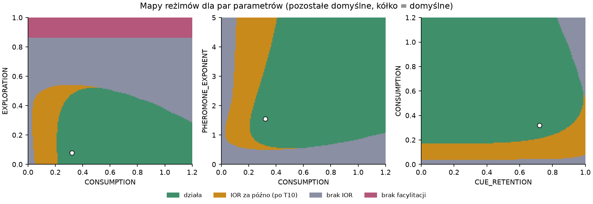
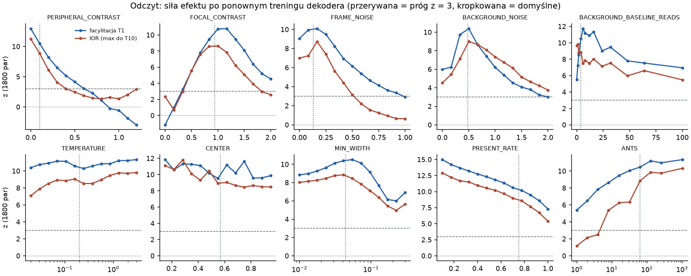
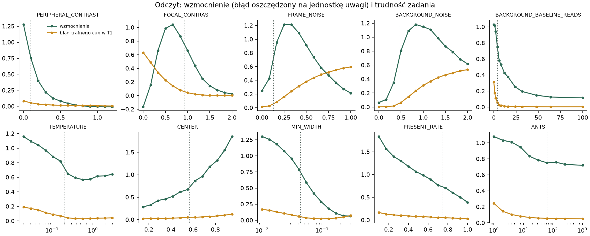
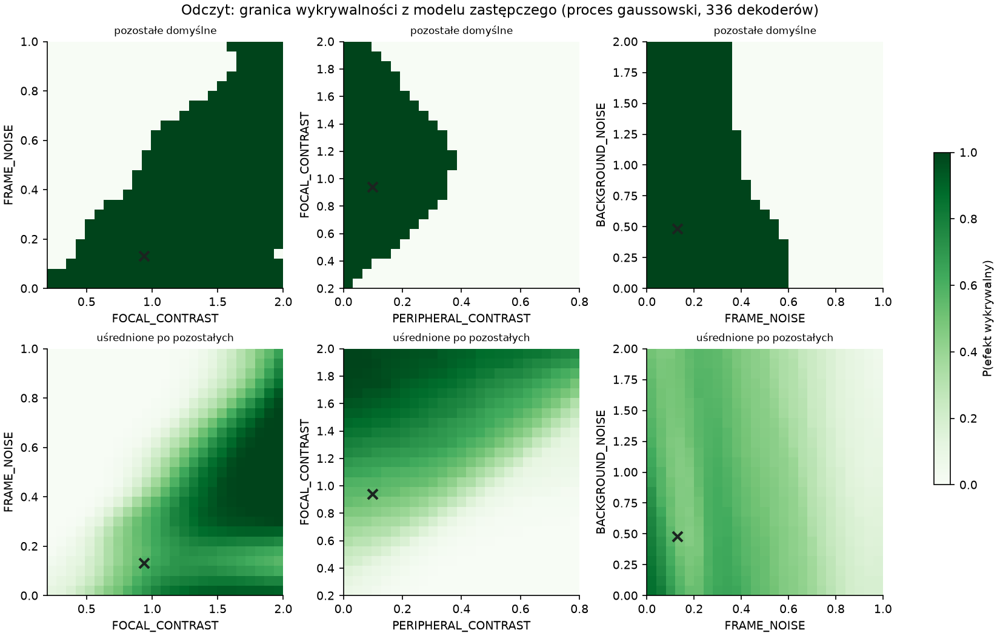

# Co wpływa na wynik modelu mrówkowego?

Model z `posner_ants.ipynb` odtwarza dwa etapy efektu Posnera: błysk najpierw pomaga wykryć cel w swoim miejscu (**facylitacja**), a później utrudnia powrót uwagi do tego miejsca (**IOR**, hamowanie powrotu). Tutaj sprawdzamy, od których parametrów zależy ten wzorzec.

**Najważniejszy wynik: kolonia ustala, gdzie trafia uwaga, a dekoder decyduje, jak dobrze widać tę zmianę w błędzie lokalizacji.** Brak IOR w odczycie może więc oznaczać słaby pomiar, a nie brak przełączenia uwagi. Wyjaśnienie działania modelu znajduje się w [MECHANISM.md](MECHANISM.md).

## Wynik przy ustawieniach domyślnych

Po błysku więcej mrówek wybiera wskazaną stronę. Ich udział osiąga 57,9% w rundzie T3, spada poniżej połowy w T8 i dochodzi do minimum 42,8% w T12–T13. Analiza ocenia jednak tylko pierwsze dziesięć rund: w T10 udział wynosi 45,2%.

To ograniczenie ma znaczenie: **małe zmiany parametrów zwykle opóźniają IOR poza T10, zamiast całkowicie je usuwać.**



## Co steruje kolonią?

Błysk przyciąga mrówki. Feromon podtrzymuje ich wybór. Zużycie zasobu sprawia, że odwiedzana strona z czasem traci atrakcyjność.

Poniższe granice pochodzą ze zmiany **jednego parametru naraz**, przy pozostałych ustawieniach domyślnych. Są przybliżone i dotyczą przyjętego okna T1–T10.

| Parametr (wartość domyślna) | Znaczenie | Kiedy wzorzec przestaje spełniać kryterium analizy |
|---|---|---|
| `CUE_STRENGTH` (0,30) | Siła początkowego przyciągania przez błysk | Poniżej 0,06 IOR jest spóźnione |
| `CUE_RETENTION` (0,72) | Jak długo działa błysk | Powyżej 0,91 IOR jest spóźnione |
| `CONSUMPTION` (0,32) | Tempo zużywania zasobu; główny czynnik głębokości IOR | Poniżej 0,21 IOR jest spóźnione; przy 0 nie występuje |
| `PHEROMONE_EXPONENT` (1,55) | Siła preferencji dla mocniejszego śladu | Poniżej 0,65 lub powyżej 3,3 IOR jest spóźnione |
| `EVAPORATION` (0,42) | Tempo zanikania starego śladu | Poniżej 0,25 kolonia zbyt długo trzyma się wcześniejszego wyboru |
| `DEPOSIT` (0,55) | Wpływ bieżących sukcesów na ślad | Poniżej 0,125 reakcja kolonii jest zbyt wolna |
| `TRAIL_FLOOR` (0,12) | Bazowa atrakcyjność obu szlaków | Powyżej 0,69 różnice między stronami są zbyt słabe |
| `EXPLORATION` (0,08) | Udział losowych wyborów, zbliżający podział do 50/50 | Powyżej 0,475 IOR jest spóźnione; przy 0,6 nie występuje |
| `INITIAL_PHEROMONE` (1,00) | Początkowy ślad na obu szlakach | Brak utraty wzorca w badanym zakresie 0–4 |

Początkowa przewaga w T1 zależy tylko od siły błysku i losowych wyborów — ślady feromonowe są wtedy jeszcze równe. Późniejszy przebieg zależy również od współdziałania parametrów. W analizie globalnej ponad połowa zmienności wyniku „działa / nie działa” wynikała z interakcji, dlatego same granice z tabeli nie wystarczą do oceny dowolnego zestawu ustawień.







## Kiedy zmianę uwagi widać w odczycie?

Dekoder lokalizuje lampkę na zaszumionym obrazie. Uwaga zwiększa jej kontrast. Efekt jest najlepiej widoczny przy pośredniej trudności: gdy zadanie jest bardzo łatwe, obie strony dają mały błąd; gdy bardzo trudne, dekoder myli się po obu stronach.

| Parametr | Wniosek z analizy |
|---|---|
| `FOCAL_CONTRAST`, `FRAME_NOISE` | Kontrast i szum klatki najmocniej wpływają na widoczność efektu. Domyślne zadanie jest dość łatwe; kontrast około 0,6 lub szum około 0,25 zwiększały czułość odczytu. |
| `PERIPHERAL_CONTRAST` | Im bliżej kontrastu przy pełnej uwadze, tym mniej uwaga może pomóc. Gdy go przekracza, uwaga szkodzi i kierunek efektu się odwraca. |
| `BACKGROUND_NOISE`, `BACKGROUND_BASELINE_READS` | Zmieniają trudność przez jakość oszacowania tła. W badanych zakresach nie usuwały efektu. |
| `MIN_WIDTH`, `CENTER`, `PRESENT_RATE` | Szerokość i położenie lampki oraz częstość jej obecności w treningu zmieniają siłę efektu. W badanych ustawieniach go nie usuwały. |
| `ANTS` | Przy najwyżej 4 mrówkach zmienność między próbami zagłuszała IOR, choć facylitacja pozostawała widoczna. |
| `TEMPERATURE` | Po ponownym treningu dekodera zmiany w zakresie 0,02–3 miały niewielki wpływ. To kandydat do uproszczenia modelu. |

**IOR jest trudniejsze do wykrycia niż facylitacja.** W oknie T1–T10 odchylenie uwagi jest mniejsze dla IOR: 4,8 wobec 6,8 punktu procentowego. Ponadto późniejsze rundy mają więcej pomiarów tła, więc zadanie staje się łatwiejsze. To może dodatkowo osłabiać widoczność IOR; udział tej przyczyny wymaga osobnego testu. Pełne minimum IOR przypada już poza oknem analizy.







## Jak oceniano wyniki?

- **Kolonia „działa”**, jeśli w T1 przewaga strony błysku wynosi co najmniej 1 punkt procentowy, a po szczycie jej udział spada poniżej 49% do T10. Osobno oznaczamy IOR opóźnione, brak IOR do T24 i brak początkowej przewagi.
- **Odczyt „działa”**, jeśli w 1800 sparowanych próbach zarówno facylitacja w T1, jak i IOR do T10 przekraczają próg `z > 3` w oczekiwanym kierunku. `z` wyraża wielkość różnicy błędów w jednostkach jej błędu standardowego.
- **Czułość odczytu** mówi, jak silnie zmiana udziału uwagi przekłada się na różnicę błędów lokalizacji.

Kolonię badano także w uproszczeniu zastępującym losowania ich średnimi (*mean-field*). Mediana różnicy względem symulacji 1800 kolonii wynosiła 0,004. To pozwoliło tanio zbadać wpływ parametrów osobno, ich interakcje (Sobol: 163 840 przebiegów; Morris: 2000) i szukać pobliskich ustawień niespełniających kryterium.

Dla parametrów odczytu trenowano dekoder ponownie; wyjątkiem było `ANTS`, które zmienia tylko kolonię. Granicę wykrywalności w sześciu wymiarach odczytu szukano bez pełnej siatki. Najpierw oceniono 192 ustawienia rozłożone równomiernie. Następnie model zastępczy (proces gaussowski) trzykrotnie wybierał po 48 ustawień tam, gdzie był najmniej pewny wyniku. W kolejnych rundach 77%, 81% i 83% nowych ustawień leżało blisko progu. Łącznie wytrenowano 336 dekoderów. Według modelu zastępczego obie części efektu są wykrywalne w około 40% badanego zakresu. Najsilniej decydują o tym `FOCAL_CONTRAST` i `FRAME_NOISE`, słabiej `PERIPHERAL_CONTRAST` i `BACKGROUND_NOISE`. Wpływ `BACKGROUND_BASELINE_READS` i `TEMPERATURE` był pomijalny.

Progi, liczba prób i okno czasowe są decyzjami analizy. Podane granice nie są uniwersalnymi właściwościami modelu.

## Pliki i uruchomienie

| Ścieżka | Zawartość |
|---|---|
| `scripts/ant_model.py` | Reguły modelu przeniesione z notebooka i trening dekodera |
| `scripts/ant_sensitivity.py` | Metody analizy parametrów kolonii |
| `scripts/run_colony_analysis.py` | Obliczenia dla kolonii |
| `scripts/run_readout_analysis.py` | Obliczenia dla odczytu |
| `scripts/make_figures.py` | Wykresy z zapisanych wyników |
| `results/colony/`, `results/readout/` | Szczegółowe wyniki w CSV, JSON i NPZ |
| `figures/` | Wykresy użyte w tym raporcie |

Z katalogu `parameter_analysis`:

```bash
pip install numpy torch scipy scikit-learn SALib matplotlib
cd scripts
python run_colony_analysis.py
python run_readout_analysis.py
python make_figures.py
```

Dla odczytu zalecane jest GPU. Przy ziarnach z notebooka (trening 83, test 50151) kopia modelu odtwarzała pierwszy przebieg do trzeciego miejsca po przecinku, z przecięciem efektów w T8.
